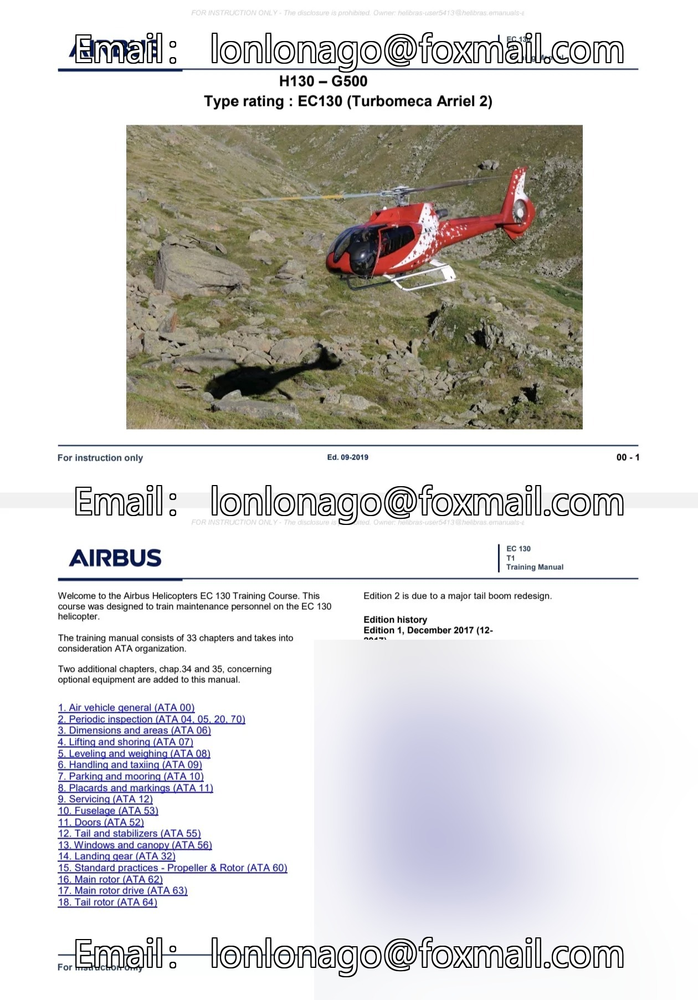
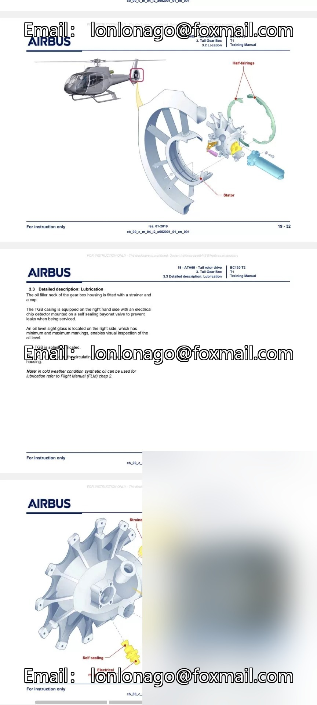
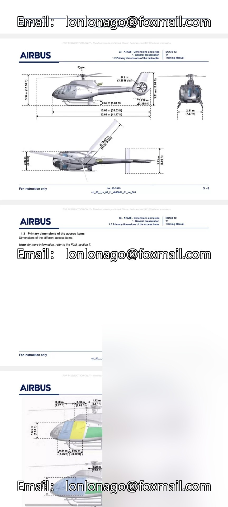

# Airbus Helicopters

## Body

Airbus Helicopters publishes the official training manual for its EC130 (H130-G500 configuration) helicopter, version 2 (09-2019).
Approximately 2,090 pages.
This "EC130 Training Manual" is a rigorous, internationally compliant, official technical training document targeting a specific configuration.
It serves not only as the core textbook for maintenance personnel to obtain the aircraft qualifications but also reflects the technical characteristics and design iterations of the Airbus H130 helicopter under the G500 configuration (such as the tail structure redesign).

Its rigorous ATA chapter organization ensures the systematicity of training and its alignment with global maintenance practices, while the explicit copyright statement emphasizes its restricted usage scope under intellectual property protection.
634452280

This is the official Airbus Helicopters training manual for EC130 helicopters, version 2 (09-2019), covering training content, structure and design information.

<!-- AI_ENRICHED -->

## Images

## Payment

Here is a pay link on Stripe ( https://buy.stripe.com/3cs8yP7sY87d0vu9AB ). Please contact me lonlonago@foxmail.com after funding $89, and I will send you a complete data files , thank you!

